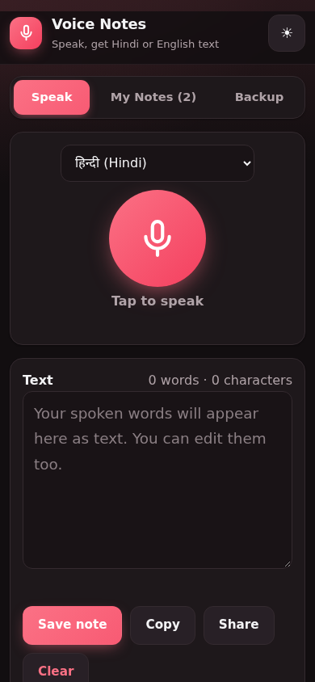
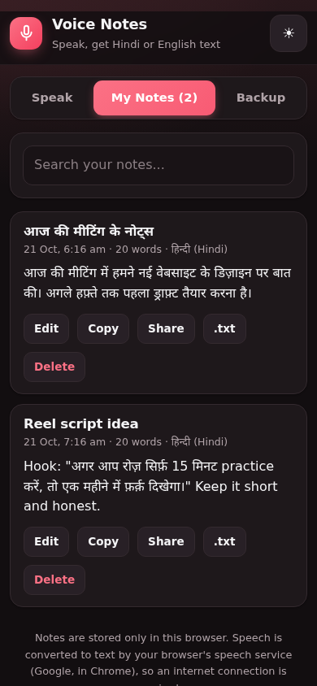
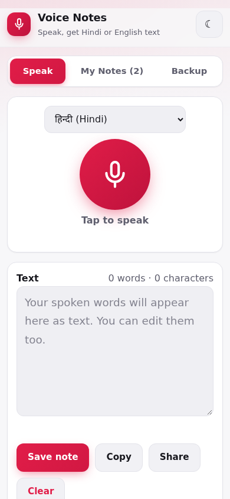
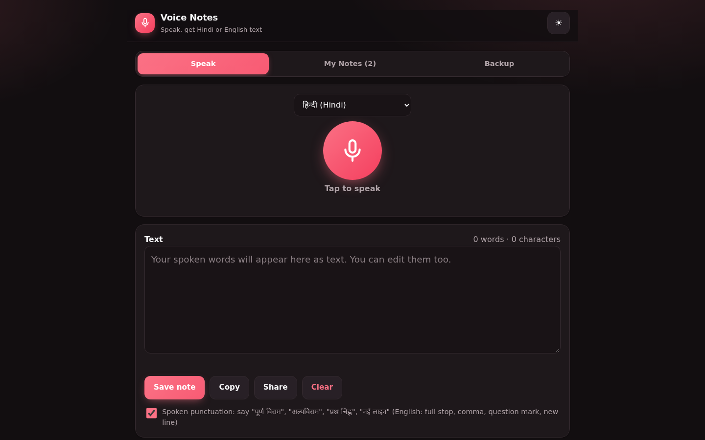

# Voice Notes - Hindi + English Speech to Text

Speak and get Hindi or English text. Built for voice notes, reel scripts and captions - with spoken punctuation commands in both languages.

**Live app:** https://akash991833.github.io/hindi-voice-notes-app/

Free, no sign-up, no ads. Works best in Chrome (Android and desktop). Notes are saved on your device only.

## Features

- Continuous Hindi (हिन्दी), English (India) and English (US) speech to text
- Spoken punctuation: say "पूर्ण विराम", "अल्पविराम", "प्रश्न चिह्न", "नई लाइन" - or "full stop", "comma", "question mark", "new line" in English
- Live word and character count, editable text area, interim results while speaking
- Notes list with search, edit, copy, share (WhatsApp / system share) and .txt download
- JSON backup and restore, plus export of all notes as one .txt file
- Dark and light mode, installable on phone

## How to use

1. Select your language, tap the mic and start speaking.
2. Edit the text if needed, then Save note.
3. Find, search, copy or share notes from the My Notes tab.
4. Use Backup regularly - notes live only in this browser.

## Screenshots







## Good to know (limits)

- Speech is converted to text by the browser's own speech service (Google, in Chrome), so an internet connection is required and accuracy depends on that service.
- iPhone Safari has limited speech recognition support; Chrome on Android or desktop works best.
- Read the text once before saving - an occasional wrong word is normal.

## Run it yourself

No build step. Clone the repo and open `index.html`, or serve the folder with any static server:

```bash
git clone https://github.com/AKASH991833/hindi-voice-notes-app.git
cd hindi-voice-notes-app
python3 -m http.server 8080
```

Plain HTML, CSS and JavaScript. No tracking, no external scripts or fonts.

## Privacy

No account, no server, no analytics. Notes stay in your browser's local storage. Audio itself is processed by the browser's speech service only when you tap the mic.

## License

MIT
